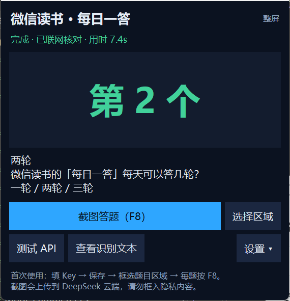

# 微信读书「每日一答」电脑版答题助手

在电脑上答微信读书的每日一答时，按一下 **F8**：程序截取你框好的题目区域，
交给 DeepSeek 看图转写 + 联网核对，然后把「第几个」显示在右上角的小窗口里。

思路同 [XiaoyuZhuang/weread](https://github.com/XiaoyuZhuang/weread)（安卓悬浮窗版），
这里是 Windows 桌面版：截图用 Pillow，界面用 tkinter，**只依赖 Python 标准库 + Pillow**。



## 三步流程

1. **看图** —— `deepseek-flash` 读截图，按固定格式转写 `QUESTION:` / `OPTION1:` …
2. **联网** —— 用题干调 DeepSeek 官方 Search API，拿回 3~8 条网页摘要；**搜不到就报错，不瞎猜**
3. **判断** —— 题干 + 选项 + 搜索摘要一起交给 Flash，只要它回答 `COUNT=n` 和 `ANSWER=k`

界面上的「识图中 / 搜索中 / 思考中」对应的就是这三步。

## 快速开始（源码）

```powershell
pip install pillow
.\启动答题助手.bat
```

1. 双击 `启动答题助手.bat`（想看报错用 `调试启动.bat`）
2. 右下角「设置 ▾」填 **DeepSeek API Key** → 保存
3. 点「测试 API」，程序会自己造一道假题跑完整链路，能显示「第 1 个 · 北京」就说明通了
4. 点「选择区域」，框住微信读书的题干 + 全部选项（松手即保存，只框一次）
5. 之后每题按 **F8**，等 3~8 秒看结果

Key 用 Windows DPAPI 加密后存在 `%APPDATA%\WereadHelper\config.json`，只有当前 Windows 用户能解开。
想让它跟着 U 盘走：先设环境变量 `WEREAD_HELPER_HOME=你的目录` 再启动。

## 打包版

`dist\` 里的两个产物（单文件 exe 29.5 MB / 便携版 zip 29.6 MB）**不放进 git**，
需要的话去 Releases 下载，或本地跑 `打包exe.ps1` 重新生成。

没有代码签名，首次运行 Windows 会提示「已保护你的电脑」→ 更多信息 → 仍要运行；
个别杀软会误判 PyInstaller 产物，被拦就换便携版。

## 依赖

- Windows 10 / 11
- Python 3.10+、Pillow（`pip install pillow`）
- 一个有余额的 DeepSeek API Key（看图、搜索、判断都走它）

完整说明见 [使用说明.md](使用说明.md)。

## 免责声明

个人学习 Windows 桌面开发与 LLM 多模态调用的练习项目。自动化操作第三方产品可能违反其用户协议，
使用后果自负，请勿用于批量代答、售卖等用途。
